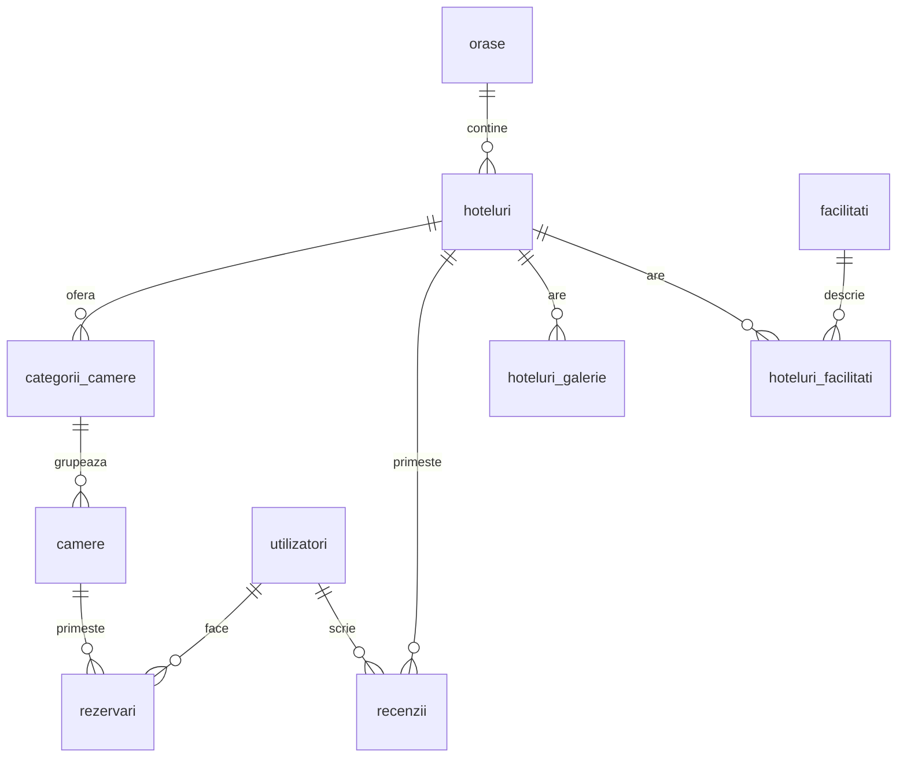

# Baza de date MySQL

Audit local din 19 octombrie 2026, făcut prin SELECT și metadatele MySQL. Nu au fost modificate schema sau datele. Acest document descrie structura; nu este un backup al înregistrărilor.

## Logica principală

Un oraș are hoteluri. Un hotel are categorii de camere, precum dublă sau apartament. O categorie are camere fizice. O rezervare leagă un utilizator de o cameră pentru un interval de timp.

Diagrama arată relațiile de domeniu. În schema actuală, unele chei externe acceptă NULL, deci legătura nu este obligatorie în toate înregistrările.

## Cele 13 tabele

| Tabel | Rol |
| --- | --- |
| `camere` | Camerele fizice și starea lor |
| `categorii_camere` | Tipurile de camere, capacitatea și prețul pe noapte |
| `coduri_reducere` | Codurile promoționale |
| `facilitati` | Catalogul facilităților |
| `hoteluri` | Datele hotelurilor și orașul fiecăruia |
| `hoteluri_facilitati` | Legătura dintre hoteluri și facilități |
| `hoteluri_galerie` | Fotografiile suplimentare ale hotelurilor |
| `oferte_sezon` | Ofertele sezoniere utilizate de API |
| `orase` | Destinațiile disponibile |
| `promotii` | Tabelă separată de promoții; fără utilizare identificată în server.js |
| `recenzii` | Evaluările hotelurilor de către utilizatori |
| `rezervari` | Camera, clientul, perioada și informațiile de plată |
| `utilizatori` | Conturi, roluri și autentificare |

Toate tabelele folosesc InnoDB. Sunt declarate 10 relații prin chei externe. Există unicitate pentru email, numele orașului, codul promoțional și perechea hotel–utilizator pentru recenzii.

## Rezultatul verificărilor datelor

| Verificare | Rezultat |
| --- | --- |
| Rezervări cu checkout ≤ checkin, preț negativ sau cameră/utilizator NULL | 0 |
| Perechi de rezervări neanulate suprapuse pe aceeași cameră | 0 |
| Sesiuni de plată nenule și nevidate duplicate | 0 |
| Categorii cu capacitate ≤ 0, preț negativ sau hotel NULL | 0 |
| Înregistrări în `promotii` | 0 |

Aceste rezultate descriu datele actuale, nu demonstrează că aplicația previne toate erorile viitoare. Verificarea suprapunerilor folosește aceeași condiție de status ca API-ul (`!= 'anulata'`); statusurile NULL nu sunt incluse de această condiție SQL.

## Ce trebuie îmbunătățit

- `promotii.id_hotel` nu are cheie externă sau index; tabela este goală și nu apare folosită în server. Clarificăm dacă se păstrează sau se consolidează cu ofertele înainte de orice eliminare.
- `rezervari.stripe_session_id` nu are index unic. Confirmările concurente de plată trebuie protejate în DB și în cod.
- Nu există constrângeri CHECK. Sunt utile pentru intervale valide, prețuri, capacitate, rating și procente, după stabilirea regulilor exacte.
- Unele legături și statusuri acceptă NULL. Verificăm dacă acest lucru este intenționat înainte să le facem obligatorii.
- Calculul disponibilității pe categorie scade numărul rezervărilor. Aceeași cameră cu două rezervări distincte în interval poate fi scăzută de două ori; camerele inactive trebuie tratate consecvent.
- Pentru rezervări concurente, verificarea și crearea rezervării trebuie proiectate împreună, într-o tranzacție cu blocarea potrivită. Un index obișnuit nu împiedică singur suprapunerile de intervale.
- MySQL local folosește `lower_case_table_names=2`; codul are denumiri cu majuscule, schema este raportată cu minuscule. Uniformizăm interogările pentru portabilitate înainte de mutarea pe un sistem sensibil la majuscule.

Nu se aplică automat niciuna dintre aceste schimbări. Mai întâi pregătim o migrare, o verificăm pe o copie a bazei și păstrăm un backup separat al datelor și imaginilor. Git păstrează codul și migrările, nu baza MySQL activă.

## Relațiile declarate

| Tabel și coloană | Referință |
| --- | --- |
| `camere.id_categorie` | `categorii_camere.id_categorie` |
| `categorii_camere.id_hotel` | `hoteluri.id_hotel` |
| `hoteluri.id_oras` | `orase.id_oras` |
| `hoteluri_facilitati.id_hotel` | `hoteluri.id_hotel` |
| `hoteluri_facilitati.id_facilitate` | `facilitati.id_facilitate` |
| `hoteluri_galerie.id_hotel` | `hoteluri.id_hotel` |
| `recenzii.id_hotel` | `hoteluri.id_hotel` |
| `recenzii.id_utilizator` | `utilizatori.id_utilizator` |
| `rezervari.id_utilizator` | `utilizatori.id_utilizator` |
| `rezervari.id_camera` | `camere.id_camera` |
