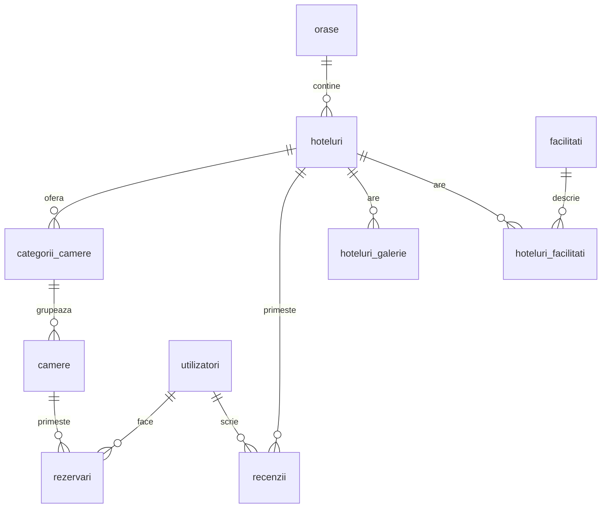

# Baza de date MySQL

Modelul relațional al bazei `licenta_booking`, utilizată de backend prin biblioteca `mysql2`. Schema completă pentru o instalare nouă este în `backend/database/schema.sql`; datele sintetice opționale sunt în `backend/database/demo.sql`. Aceste fișiere nu conțin înregistrări din baza utilizatorului.

## Logica principală

Un oraș are hoteluri. Un hotel are categorii de camere, precum dublă sau apartament. O categorie are camere fizice. O rezervare leagă un utilizator de o cameră pentru un interval de timp.

Diagrama arată relațiile de domeniu. În schema actuală, unele chei externe acceptă NULL, deci legătura nu este obligatorie în toate înregistrările.

## Cele 13 tabele

| Tabel | Rol |
| --- | --- |
| `camere` | Camerele fizice și starea lor |
| `categorii_camere` | Tipurile de camere, capacitatea și prețul pe noapte |
| `coduri_reducere` | Codurile promoționale |
| `facilitati` | Catalogul facilităților |
| `hoteluri` | Datele hotelurilor și orașul fiecăruia |
| `hoteluri_facilitati` | Legătura dintre hoteluri și facilități |
| `hoteluri_galerie` | Fotografiile suplimentare ale hotelurilor |
| `oferte_sezon` | Ofertele sezoniere utilizate de API |
| `orase` | Destinațiile disponibile |
| `promotii` | Tabelă separată de promoții; fără utilizare identificată în server.js |
| `recenzii` | Evaluările hotelurilor de către utilizatori |
| `rezervari` | Camera, clientul, perioada și informațiile de plată |
| `utilizatori` | Conturi, roluri și autentificare |

Toate tabelele folosesc InnoDB. Sunt declarate 10 relații prin chei externe. Există unicitate pentru email, numele orașului, codul promoțional și perechea hotel–utilizator pentru recenzii.

## Relațiile declarate

| Tabel și coloană | Referință |
| --- | --- |
| `camere.id_categorie` | `categorii_camere.id_categorie` |
| `categorii_camere.id_hotel` | `hoteluri.id_hotel` |
| `hoteluri.id_oras` | `orase.id_oras` |
| `hoteluri_facilitati.id_hotel` | `hoteluri.id_hotel` |
| `hoteluri_facilitati.id_facilitate` | `facilitati.id_facilitate` |
| `hoteluri_galerie.id_hotel` | `hoteluri.id_hotel` |
| `recenzii.id_hotel` | `hoteluri.id_hotel` |
| `recenzii.id_utilizator` | `utilizatori.id_utilizator` |
| `rezervari.id_utilizator` | `utilizatori.id_utilizator` |
| `rezervari.id_camera` | `camere.id_camera` |

## Conectarea aplicației

`backend/src/config/env.js` încarcă setările private din `backend/.env`. `backend/src/config/db.js` creează pool-ul comun de conexiuni folosind `DB_HOST`, `DB_USER`, `DB_PASSWORD`, `DB_PORT` și `DB_NAME`. Backendul execută SQL și trimite rezultatele ca JSON către frontend. MySQL Workbench este un client separat pentru inspectarea aceleiași baze, nu un intermediar folosit de aplicație.

## Constrângeri și portabilitate

- Schema unei instalări noi folosește aceleași denumiri de tabele ca interogările, inclusiv pe servere sensibile la majuscule. Baza locală existentă nu este redenumită automat.
- Unele legături și statusuri acceptă `NULL`; disponibilitatea tratează un status necunoscut ca ocupat. Validarea aplicației verifică intervalele, ID-urile, capacitatea și valorile monetare.
- Schema nouă include `uq_rezervari_stripe_session`, unic pe `stripe_session_id`, și un index pentru cameră/perioadă. Aceste indexuri nu au fost aplicate bazei existente. Protecția concurenței din cod funcționează prin blocarea camerei pe toate fluxurile de salvare și reactivare; testele verifică și cazul fără index unic.
- `promotii` este păstrată pentru compatibilitatea schemei. Nu există utilizare identificată în API.
- Inițializarea refuză o bază care conține deja tabele. Pentru o bază existentă sunt necesare migrări separate, revizuite și susținute de backup.

Detaliile tranzacțiilor, calculului prețurilor și confirmării Stripe sunt descrise în [arhitectura aplicației](STRUCTURA.md).
