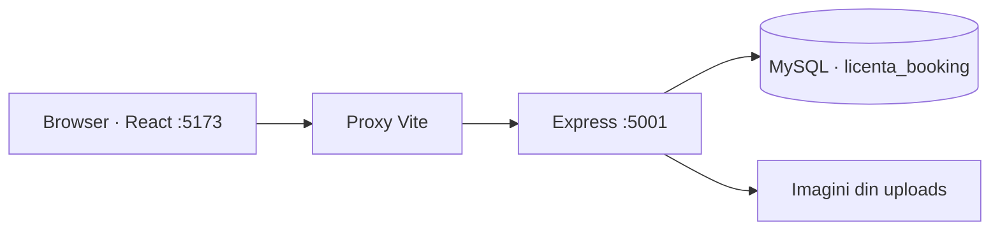

# Structura proiectului

## Cum circulă o cerere



React afișează informațiile. Express verifică cererea și citește/scrie în MySQL. Browserul nu se conectează direct la baza de date.

## Ce păstrăm și de ce

- `node_modules`: biblioteci terțe, regenerate cu npm. Nu reprezintă cod scris pentru licență.
- `migratii`: modificări istorice ale structurii bazei. Unele au configurație DB hardcodată; trebuie revizuite înainte de folosire. Nu sunt un sistem complet, ordonat și versionat de migrare.
- `fonts`: există un font Roboto local, dar generatorul PDF din `server.js` folosește încă două căi absolute Windows către Arial. Generarea PDF pe Mac necesită o reparație separată, cu fonturi portabile și verificarea diacriticelor.
- `uploads`: fișiere asociate hotelurilor. Un backup al bazei nu include automat aceste imagini. O imagine referită de hotelul 1 lipsește din copia locală.
- `.env`: configurație privată; rămâne local și este ignorată de Git.

## Reorganizare propusă, încă neimplementată

```text
backend/
  server.js                 # pornirea serverului
  src/
    app.js                  # configurarea Express
    config/                 # mediu și conexiune DB
    middleware/             # autentificare și tratarea erorilor
    modules/
      hoteluri/             # rute, interogări, disponibilitate
      rezervari/
      autentificare/
      administrare/
    services/               # email, PDF, plăți
  migratii/                 # viitoare migrări numerotate și documentate
frontend/src/
  pages/                    # pagini care compun componente
  components/               # componente comune
  features/                 # componente și hook-uri specifice unei funcții
```

Nu mutăm totul simultan. Extragem un domeniu, verificăm aceleași răspunsuri API și aceeași interfață, apoi facem un commit. Modificările logicii se păstrează separat de simpla mutare a codului.

## Ordinea recomandată

1. Checkpoint al variantei funcționale și documentație clară.
2. Extragerea configurației DB și a modulului hoteluri/disponibilitate; teste pentru intervale și camere ocupate.
3. Corectarea disponibilității și verificarea rezervărilor concurente, fără a modifica rezervările existente.
4. Extragerea componentelor mari din dashboardul admin și pagina hotelului; remedierea lintului.
5. Retușuri vizuale: spațiere, tipografie, butoane și formulare consecvente, stări de încărcare/eroare și afișare pe mobil. Păstrăm direcția cromatică bleumarin–auriu; comparăm vizual fiecare pagină modificată.
6. Chatbot pentru disponibilitate, bazat pe același serviciu folosit de căutare. Cere hotel/oraș, perioada și numărul de persoane; nu inventează camere disponibile.

## Verificări existente

Buildul frontend trece; bundle-ul principal depășește 500 kB. Încărcarea paginilor la cerere poate fi introdusă separat.

Ultima rulare ESLint a raportat 34 de erori și 7 avertismente. Buildul reușit nu înseamnă că aceste probleme au fost rezolvate.

Rutele publice pentru orașe, hoteluri, hartă, oferte și disponibilitate au fost verificate prin cereri de citire. Nu au fost testate în această etapă toate fluxurile de autentificare, plăți, email sau administrare.
