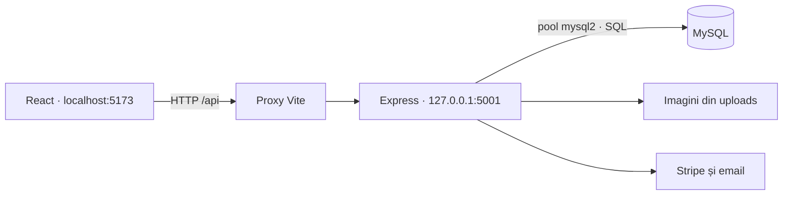

# Arhitectura aplicației

## Fluxul unei cereri



React trimite cereri HTTP și afișează răspunsuri JSON. Express validează intrările, autentifică utilizatorul și accesează MySQL. Browserul nu se conectează direct la baza de date.

## Structura backendului

```text
backend/
  server.js                 # verificarea DB, pornirea și oprirea serverului
  src/
    app.js                  # construirea aplicației și înregistrarea modulelor
    config/                 # mediu, setări HTTP și pool MySQL
    middleware/auth.js      # JWT și verificarea rolului actual din DB
    modules/
      hoteluri/             # catalog, hartă, căutare și disponibilitate
      autentificare/        # conturi, profil și resetarea parolei
      rezervari/            # creare, listare, anulare și PDF
      plati/                # checkout, confirmare și webhook Stripe
      administrare/         # hoteluri, utilizatori, oferte și rapoarte
      oferte/               # oferte publice și validarea reducerilor
      recenzii/             # recenzii condiționate de un sejur încheiat
    services/               # rezervări, plăți, validare, email, PDF și uploads
  database/                 # schemă MySQL 8, date demo și inițializare protejată
  test/                     # teste unitare, HTTP și integrare MySQL
  fonts/                    # fonturi Roboto locale și licența lor
  uploads/                  # imagini încărcate
  migratii/                 # scripturi istorice, independente de pornire
```

`createApp` primește dependențele prin parametri pentru a permite teste fără servicii externe. Pornirea serverului este separată de importul aplicației. Erorile neprevăzute au răspuns JSON comun, fără SQL sau configurație privată. Upload-urile au limită de dimensiune și extensii permise.

Frontendul este organizat în `pages/`, `components/` și `assets/`. `api.js` definește adresa comună, iar `vite.config.js` redirecționează `/api` și `/uploads` către backend în dezvoltare.

## Disponibilitate și rezervări

Camera trebuie să fie activă și să nu aibă o rezervare neanulată care satisface:

```text
rezervare.checkin < cerere.checkout
AND rezervare.checkout > cerere.checkin
```

Checkout-ul este exclus: alt sejur poate începe în aceeași zi. Statusul `NULL` este tratat conservator ca ocupat. Numărarea folosește camerele, fără scăderea repetată a aceleiași camere sau a camerelor inactive. `/hoteluri/search` și `/hoteluri/cauta` folosesc aceeași implementare; prețul minim și numărul disponibil se calculează pe camerele care corespund filtrelor. Fără interval, disponibilitatea reprezintă inventarul activ.

Crearea unei rezervări folosește o conexiune dedicată și o tranzacție. Camera este blocată prin `FOR UPDATE`, apoi disponibilitatea este reverificată înainte de inserare. Codul de reducere este blocat și consumat în aceeași tranzacție. Erorile produc rollback. Reactivarea unei rezervări anulate aplică aceeași verificare de suprapunere.

Prețurile sunt calculate în bani întregi din tariful DB și numărul nopților. Reducerea, avansul de 30% și comisionul de 10% sunt rotunjite la ban. Totalurile trimise de client nu sunt folosite pentru autorizarea sumei. O rezervare cash nu poate declara o plată online efectuată.

## Confirmarea plății

Sesiunea Stripe conține oferta calculată de server. Confirmarea verifică proprietarul, starea plății, suma, moneda și eventualele rambursări. Confirmările concurente sunt serializate pe camera asociată; o sesiune deja salvată returnează aceeași rezervare. Schema pentru instalări noi include și un index unic pentru sesiunea Stripe.

Webhook-ul verifică semnătura pe corpul brut al cererii și folosește același serviciu de confirmare ca browserul. Conflictele de disponibilitate sau reducere după o plată reușită inițiază un refund cu cheie idempotentă. Erorile tehnice rămân reîncercabile. Emailul este trimis după salvare și nu condiționează tranzacția.

Nu sunt blocate camere pentru întreaga durată a checkout-ului. Două checkout-uri pot ajunge la plată, dar numai rezervarea eligibilă este salvată; cealaltă plată este rambursată la confirmare. Sesiunile create înainte de versiunea actuală, plătite dar încă nesalvate, necesită verificare manuală.

## Configurație și limite

- JWT este verificat criptografic; rolul și existența contului se recitesc din DB la fiecare cerere protejată.
- Tokenurile noi de resetare a parolei sunt păstrate ca digest SHA-256 și consumate printr-un UPDATE condiționat. Linkurile vechi trebuie solicitate din nou.
- Actualizarea codului nu aplică migrări și nu modifică automat înregistrările existente. Anularea unei rezervări nu declanșează automat refund; politica și operațiunea de rambursare trebuie tratate separat.
- PDF-urile folosesc fonturi incluse local, cu diacritice românești. Conținutul fiscal și cota TVA din documentul demonstrativ necesită validare înainte de utilizare comercială.
- Scripturile istorice din `migratii/` nu reprezintă instalarea de la zero și nu se rulează automat. `database/init.js` refuză baze cu tabele existente.
- O imagine referită de baza locală lipsește. Baza MySQL și imaginile necesită backup separat.
- Problemele ESLint și dimensiunea bundle-ului frontend sunt încă deschise. Apelurile reale Stripe/Gmail se verifică separat de suita automată.

`.env`, regulile locale de lucru, dependențele instalate și rezultatele buildului nu sunt publicate în Git.
