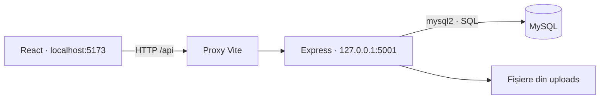

# Arhitectura aplicației

## Fluxul unei cereri



React trimite cereri HTTP și afișează răspunsurile JSON. Express execută interogările SQL prin `mysql2`. Frontendul nu accesează direct baza de date. Imaginile încărcate sunt servite din directorul `backend/uploads/`; MySQL păstrează referințele către ele.

## Structura actuală

```text
backend/
  server.js                 # Express, autentificare, rezervări, administrare și integrări
  src/
    config/
      env.js                # încărcarea backend/.env
      db.js                 # conexiunea MySQL comună
    modules/
      hoteluri/
        routes.js           # catalog, căutare, hartă și disponibilitate
  test/                     # teste de rutare și verificări SQL
  migratii/                 # scripturi istorice de modificare a bazei
  fonts/                    # resurse de font
  uploads/                  # imagini încărcate
frontend/
  src/
    pages/                  # paginile publice și panoul de administrare
    components/             # navigare, notificări și componente comune
    assets/                 # imagini incluse în aplicație
    api.js                  # adresa de bază pentru cererile API
  public/                   # resurse statice
  vite.config.js            # dezvoltare și proxy către backend
```

`server.js` încarcă configurația, pornește conexiunea DB și înregistrează rutele. Modulul hoteluri primește aceeași conexiune prin parametrul `db`, ceea ce permite verificarea rutelor cu o conexiune simulată. Majoritatea celorlalte domenii sunt încă implementate în `server.js`.

`backend/creeaza_admin.js` este utilitarul interactiv de creare a unui administrator. Acesta și scripturile din `migratii/` folosesc conexiunea comună configurată prin `backend/.env` și sunt independente de pornirea aplicației. Migrările istorice nu constituie un sistem complet de inițializare sau migrare a bazei.

## Disponibilitatea camerelor

O cameră este ocupată dacă o rezervare neanulată se suprapune cu perioada căutată:

```text
rezervare.checkin < cerere.checkout
AND rezervare.checkout > cerere.checkin
```

Checkout-ul este exclus din interval: un sejur poate începe în ziua în care se termină altul. Testele MySQL verifică limitele intervalelor, suprapunerile și rezervările anulate, folosind camere și rezervări sintetice definite în CTE-uri, fără scrieri în baza existentă.

## Limitări cunoscute

- Disponibilitatea pe categorie poate scădea aceeași cameră de mai multe ori și poate include în scădere rezervările camerelor inactive. Testele de caracterizare reproduc aceste defecte.
- `/api/hoteluri/cauta` este interceptată de ruta `/:id`. Frontendul folosește `/api/hoteluri/search`. Căutările nu aplică încă reguli identice pentru preț și camere disponibile; validarea parametrilor este incompletă.
- Verificarea disponibilității și salvarea rezervării nu sunt protejate împreună prin tranzacții și blocare; rezervările concurente nu sunt garantate fără suprapuneri.
- Generatorul PDF folosește căi absolute Windows pentru fonturile Arial. Fontul local nu este conectat la generator, astfel că generarea PDF nu este portabilă în forma actuală.
- O imagine referită de baza locală lipsește. Fișierele încărcate și baza de date necesită copii de siguranță separate.
- Frontendul are probleme ESLint existente, iar buildul raportează un bundle principal de peste 500 kB. Testele actuale nu acoperă integral autentificarea, administrarea, plățile și emailurile.

Fișierele `.env`, dependențele instalate și rezultatele de build sunt excluse din Git. Baza MySQL reală și configurația privată nu sunt incluse în repository.
