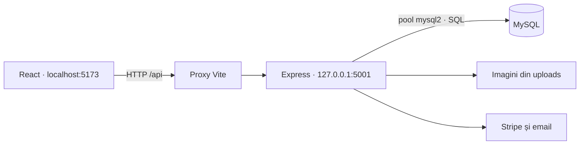

# Arhitectura aplicației

## Fluxul unei cereri



React trimite cereri HTTP și afișează răspunsuri JSON. Express validează intrările, autentifică utilizatorul și accesează MySQL. Browserul nu se conectează direct la baza de date.

## Structura backendului

```text
backend/
  server.js                 # verificarea DB, pornirea și oprirea serverului
  src/
    app.js                  # construirea aplicației și înregistrarea modulelor
    config/                 # mediu, setări HTTP și pool MySQL
    middleware/auth.js      # JWT și verificarea rolului actual din DB
    modules/
      hoteluri/             # catalog, hartă, căutare și disponibilitate
      autentificare/        # conturi, profil și resetarea parolei
      rezervari/            # creare, listare, anulare și PDF
      plati/                # checkout, confirmare și webhook Stripe
      administrare/         # hoteluri, utilizatori, oferte și rapoarte
      oferte/               # oferte publice și validarea reducerilor
      recenzii/             # recenzii condiționate de un sejur încheiat
    services/               # catalog, tranzacții, rezervări, plăți, validare, email, PDF și uploads
  database/                 # schemă MySQL 8, date demo și inițializare protejată
  test/                     # teste unitare, HTTP și integrare MySQL
  fonts/                    # fonturi Roboto locale și licența lor
  uploads/                  # imagini încărcate
  migratii/                 # scripturi istorice, independente de pornire
```

`createApp` primește dependențele prin parametri pentru a permite teste fără servicii externe. Pornirea serverului este separată de importul aplicației. Erorile neprevăzute au răspuns JSON comun, fără SQL sau configurație privată. Upload-urile au limită de dimensiune și extensii permise.

Frontendul este organizat în `pages/`, `components/`, `hooks/`, `utils/`, `styles/` și `assets/`. Paginile sunt încărcate separat prin `lazy` și `Suspense`. Panoul administrativ are componente separate pentru fiecare secțiune, un hook pentru încărcarea datelor și module pentru stiluri și calcule. Sesiunea este urmărită prin `useSyncExternalStore`, inclusiv la schimbările din alte taburi. Cererile de căutare vechi sunt anulate când filtrele se schimbă; descărcarea PDF și tratarea fotografiilor indisponibile sunt comune paginilor. `api.js` definește adresa comună, iar `vite.config.js` redirecționează `/api` și `/uploads` către backend în dezvoltare.

## Asistentul de căutare

`frontend/src/features/Assistant.jsx` afișează panoul pe pagina principală și în catalog. `features/assistant/AiConversation.jsx` gestionează conversația AI, rezultatele, rezumatul și confirmarea căutării, precum și vederile separate pentru istoric, criterii și opțiuni. `Assistant.jsx` controlează deschiderea, închiderea și dimensiunea panoului: extins pe înălțimea ecranului, aproximativ 25% din lățime (minimum 390 px, maximum 680 px), sau compact. Pe telefon, varianta extinsă ocupă ecranul. Derularea conversației poziționează începutul răspunsului nou, fără a sări la ultimul hotel din listă. Modulul backend `src/modules/assistant/` expune `GET /api/assistant/status` (doar disponibilitatea configurației) și `POST /api/assistant/chat`. Acesta din urmă acceptă istoricul pentru interpretare AI, un obiect de criterii presetate sau o cerere de catalog explicită. Ultimele două variante sunt validate fără apel la model. `src/modules/assistant/catalog.js` răspunde despre orașele cu hoteluri, hoteluri pe oraș, descrierea, facilitățile și categoriile unui hotel. Folosește exclusiv SELECT și alege ID-ul hotelului din catalog; textul modelului nu devine SQL. Întrebările uzuale sunt recunoscute direct, iar intențiile suplimentare pot fi extrase prin Groq. Lista hotelurilor afișează maximum opt rezultate dintr-o citire limitată la 100 de hoteluri. Disponibilitatea pentru un interval rămâne separată de prezentarea catalogului.

Backendul trimite la Groq un istoric limitat de mesaje și numele orașelor din catalog, solicitând JSON conform unei scheme stricte. Verifică suplimentar tipurile, datele, orașele, vârstele, sumele și unitatea bugetului. Modelul interpretează cererea; mesajele despre plăți și operațiuni sunt produse de reguli controlate. Rezultatul modelului nu este folosit ca SQL, URL sau operațiune executabilă. Eșecurile temporare HTTP și generările JSON refuzate sunt reîncercate o singură dată. Fiecare apel are timeout de 20 de secunde; limita locală este de maximum două apeluri simultane și zece apeluri pe minut pentru întreaga instanță privată. Istoricul este limitat la 12 mesaje de utilizator și 12.000 de caractere, fără stocare persistentă pe server. Frontendul păstrează maximum zece conversații locale, separat după identificatorul contului, cu restaurare și ștergere. Rezultatele și dreptul de a căuta nu sunt restaurate ca disponibilitate confirmată. Filtrul pentru date sensibile recunoaște emailuri, unele formate de card și chei; acesta nu garantează anonimizarea textului liber.

Bugetul AI poate fi pentru întregul grup pe noapte, pentru sejur sau fără limită. Bugetul pe sejur este convertit conservator la un plafon pe noapte, rotunjit în jos la ban. După confirmarea rezumatului, frontendul folosește ruta existentă `GET /api/hoteluri/search`. Sunt afișate maximum cinci hoteluri, cu preț pe cameră/noapte și total pentru perioada aleasă. Alegerea hotelului încarcă din nou disponibilitatea categoriilor; categoriile fără camere libere, fără capacitate suficientă sau peste buget sunt excluse. Linkul de checkout transmite hotelul, categoria, perioada și persoanele și precizează o cameră. Căutarea AI este activată numai pentru adulți într-o cameră comună; camerele multiple și politicile pentru copii nu sunt implementate în rezervarea actuală. Nu sunt create rezervări, plăți, anulări sau cereri de rambursare prin conversație.

Interfața este o singură conversație: răspunsurile rapide și formularul „Criterii de cazare” completează aceleași criterii ca AI-ul. Presetele permit continuarea fără furnizor. `src/modules/assistant/language.js` detectează prin reguli indicii românești și englezești din mesajele utilizatorului, păstrând limba pentru răspunsuri fără indicii clare. Româna este implicită pentru conversații noi. `features/assistant/language.js` conține traducerile interfeței, iar răspunsurile controlate sunt disponibile în ambele limbi în backend. Limba nu se deduce din limba browserului și nu necesită un apel suplimentar la furnizor. Textele originale ale hotelurilor nu sunt traduse automat. `features/assistant/history.js` gestionează istoricul local și limba conversației, iar `features/assistant/assistant.css` stilurile responsive. Testele backend injectează un client Groq simulat; Playwright verifică conversația, presetele, istoricul, erorile și navigarea la checkout, inclusiv pe telefon, fără servicii externe sau scrieri MySQL.

## Disponibilitate și rezervări

Camera trebuie să fie activă și să nu aibă o rezervare neanulată care satisface:

```text
rezervare.checkin < cerere.checkout
AND rezervare.checkout > cerere.checkin
```

Checkout-ul este exclus: alt sejur poate începe în aceeași zi. Statusul `NULL` este tratat conservator ca ocupat. Numărarea folosește camerele, fără scăderea repetată a aceleiași camere sau a camerelor inactive. `/hoteluri/search` și `/hoteluri/cauta` folosesc aceeași implementare; prețul minim și numărul disponibil se calculează pe camerele care corespund filtrelor. Fără interval, disponibilitatea reprezintă inventarul activ.

Crearea unei rezervări folosește o conexiune dedicată și o tranzacție. Camera este blocată prin `FOR UPDATE`, apoi disponibilitatea este reverificată înainte de inserare. Codul de reducere este blocat și consumat în aceeași tranzacție. Erorile produc rollback. Reactivarea unei rezervări anulate aplică aceeași verificare de suprapunere. Crearea categoriilor și camerelor este atomică. Ștergerea hotelurilor și categoriilor blochează inventarul și verifică existența oricăror rezervări, inclusiv anulate, înainte de ștergere; istoricul nu poate fi eliminat prin aceste rute.

Prețurile sunt calculate în bani întregi din tariful DB și numărul nopților. Reducerea, avansul de 30% și comisionul de 10% sunt rotunjite la ban. Totalurile trimise de client nu sunt folosite pentru autorizarea sumei. O rezervare cash nu poate declara o plată online efectuată.

## Confirmarea plății

Sesiunea Stripe conține oferta calculată de server. Confirmarea verifică proprietarul, starea plății, suma, moneda și eventualele rambursări. Confirmările concurente sunt serializate pe camera asociată; o sesiune deja salvată returnează aceeași rezervare. Schema pentru instalări noi include și un index unic pentru sesiunea Stripe.

Webhook-ul verifică semnătura pe corpul brut al cererii și folosește același serviciu de confirmare ca browserul. Conflictele de disponibilitate sau reducere după o plată reușită inițiază un refund cu cheie idempotentă. Erorile tehnice rămân reîncercabile. Emailul este trimis după salvare și nu condiționează tranzacția. O eroare de email nu transformă o rezervare sau anulare salvată într-un răspuns de eroare. Notificările eșuate sunt înregistrate în log; nu există încă o coadă persistentă pentru retrimitere.

Nu sunt blocate camere pentru întreaga durată a checkout-ului. Două checkout-uri pot ajunge la plată, dar numai rezervarea eligibilă este salvată; cealaltă plată este rambursată la confirmare. Sesiunile create înainte de versiunea actuală, plătite dar încă nesalvate, necesită verificare manuală.

## Configurație și limite

- JWT este verificat criptografic; rolul și existența contului se recitesc din DB la fiecare cerere protejată.
- Tokenurile noi de resetare a parolei sunt păstrate ca digest SHA-256 și consumate printr-un UPDATE condiționat. Linkurile vechi trebuie solicitate din nou.
- Actualizarea codului nu aplică migrări și nu modifică automat înregistrările existente. Anularea unei rezervări nu declanșează automat refund; politica și operațiunea de rambursare trebuie tratate separat.
- PDF-urile folosesc fonturi incluse local, cu diacritice românești. Conținutul fiscal și cota TVA din documentul demonstrativ necesită validare înainte de utilizare comercială.
- Scripturile istorice din `migratii/` nu reprezintă instalarea de la zero și nu se rulează automat. `database/init.js` refuză baze cu tabele existente.
- O imagine referită de baza locală lipsește; frontendul afișează un înlocuitor local pentru fotografiile indisponibile. Baza MySQL și imaginile necesită backup separat.
- Testele frontend includ redare de componente, teste Playwright cu API simulat și un flux opțional cu backend și MySQL temporar (`TEST_MYSQL=1`). Serviciile externe și înregistrările existente nu sunt utilizate de testele de browser. Apelurile reale Stripe/Gmail se verifică separat de suita automată.

`.env`, regulile locale de lucru, dependențele instalate și rezultatele buildului nu sunt publicate în Git.
